

# Forever Controller Tweaks

**Play WoW Forever on a controller your way.** Choose which bumper or trigger opens each crossbar bar and targeting mode, put any spell, item or action on any face or D-pad button, type in chat with an on-screen keyboard, open your own action rings, and tap spells on screen when you play through Steam Link. The glyphs always match the buttons you press, and you set everything up with the controller.

[CurseForge][curseforge] · [Wago][wago] · [Website][site] · [Download][releases] · [User guide](docs/user-guide.md) · [Controllers](docs/controllers.md) · [Changelog](CHANGELOG.md)

## What it does

Forever Controller Tweaks builds on WoW Forever's own Gamepad UI instead of replacing it. Out of the box the Gamepad UI fixes the crossbar: L2 and R2 open the left and right bars, L1 holds friendly targeting and R1 holds hostile targeting, and Jump, Interact, Back and Inspect sit on fixed face buttons. This addon lets you change all of that. For example, **L2 opens the left bar, L1 the right bar, R1 targets friends and R2 targets enemies.** It changes the game's own controller mapping, so every native bar, glyph and targeting mode keeps working. Only the buttons change.

## Features

- **On-screen keyboard.** A radial keyboard in Forever's style opens on any text box: chat, whispers, bag search, mail, macros. Both sticks type, it places itself clear of the chat window, the crossbar and your unit frame, and every button can be rebound.
- **Smart suggestions.** 263 hand-written lines for 25 situations (ready check, resurrect, summon, invite, trade, dungeon, raid, city, guild and more), replies to chat aimed at you (25 intent rules recognise 125 phrases such as "inv?", "LF healer" and "ready?"), progress for the quest you follow, shorthands like lf, brb and omw, and next-word prediction that learns how you write. Each kind of box gets its own list, like item names in bag search. All offline: nothing is ever sent for you, and only your own sent messages are learned from.
- **Action rings.** Build up to 12 radial menus of 4 to 12 slots, each with a name and any icon from the game's macro icons, filled from the same action list as the bindings. Put a ring on any face, D-pad or touch button: hold it, aim with the stick, release (centred cancels). Aim with the **Right** stick, the **Left** stick, or **Dynamic** (the hand that isn't on the button), per ring. Works in combat, and uses no hidden action slots.
- **Remap the modifiers.** Right on the Bindings screen, give the left bar, right bar, friendly targeting and hostile targeting to any of L1, R1, L2, R2 or the back paddles. Picking a role another button already has swaps the two. One preset sets "Left = bars, Right = targeting".
- **Any action on any button.** Every face and D-pad button, and any back paddle without a role, on every bar (top, left, right and bottom) can hold a spell, item, toy, mount, equipment set, macro or game action. Jump, Interact, Back and Inspect can go anywhere too, and Interact keeps hold-to-loot.
- **Buttons that behave like native ones.** Moved actions show cooldowns, range, mana, charges, proc glow and tooltips, and respond to mouse clicks, exactly like the game's own slots.
- **Spell ranks.** Spells with ranks are grouped. Pick a specific rank, or **Highest Rank**, which moves up by itself when you learn a new one.
- **Other addons' buttons.** Key bindings from other addons (for example WellMet) can go on any controller button, from the picker's AddOns category.
- **Touch bars.** Two bars on the left and right edges of the screen for tapping spells, made for Steam Link on a phone or tablet. Each button has an action per bar (top, left, right, bottom), following your modifiers. Per side, choose how many buttons, their size, position, shape (circle or square) and whether empty buttons show, and when the bars show. They're off until you turn them on.
- **Glyphs that match.** The bar hints, class prompts, targeting markers and on-screen legend show the buttons you actually press, in Xbox, PlayStation or Nintendo style. With both targeting roles on one side, the targeting marker splits into a friendly and a hostile half.
- **Any controller.** If the game doesn't recognise your pad, pick its layout (PlayStation, Xbox or Switch) from a card, or press each button once to teach it.
- **Controller-first settings.** Four tabs (Bindings, Touch, Keyboard, Rings) in Forever's own look, driven entirely with the D-pad, with the controller drawn in the middle so you see which button you're editing. Triangle opens **More** on every screen.
- **Leaves no trace.** Logging out or disabling the addon puts the game's controller setup back to default.

## Screenshots

| | |
|---|---|
| 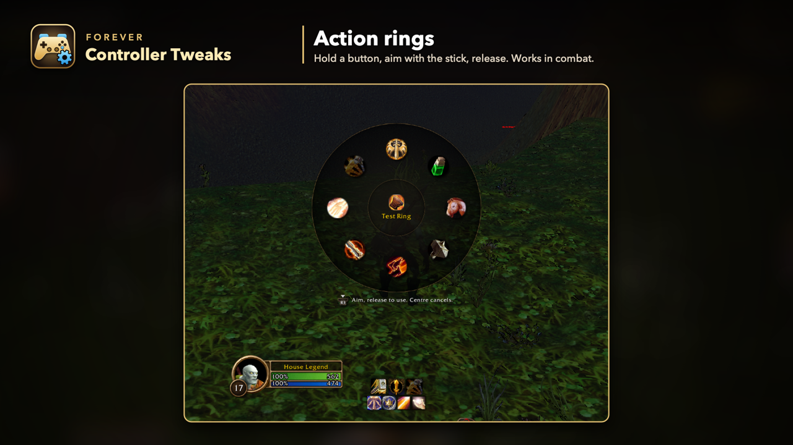 | 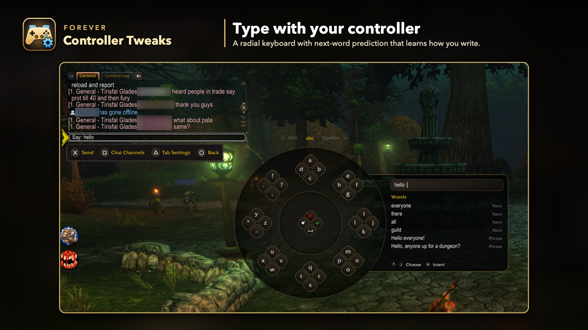 |
| 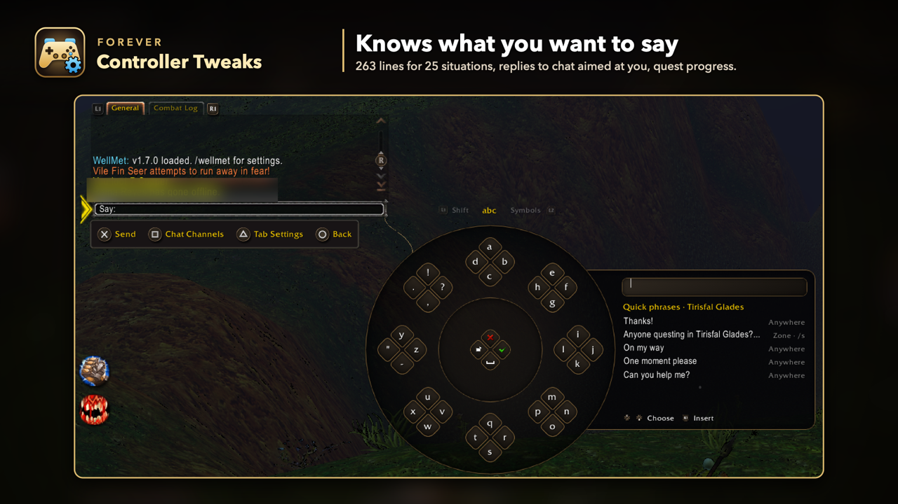 | 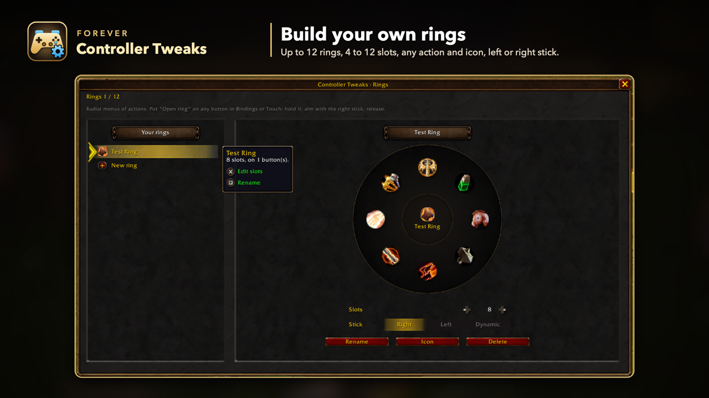 |
| 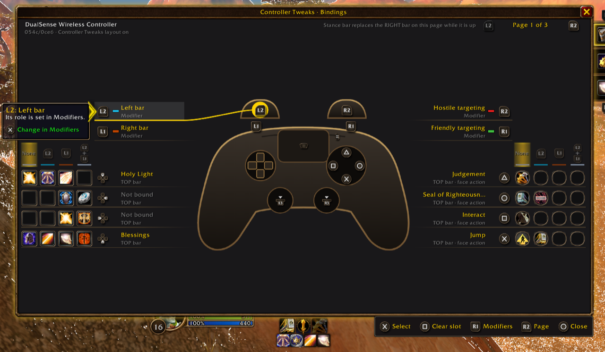 | 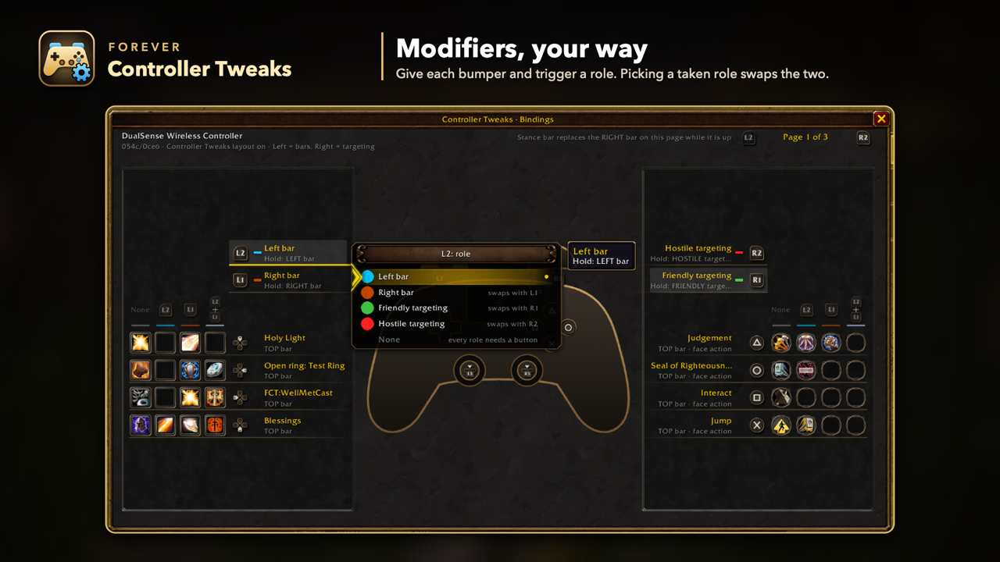 |
| 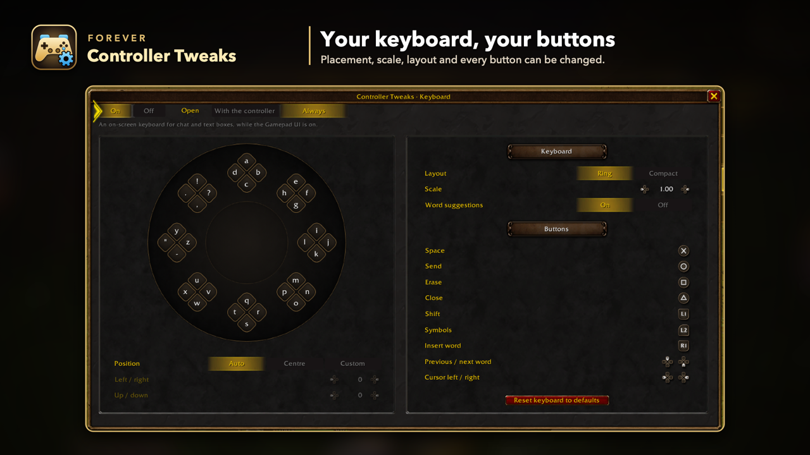 | 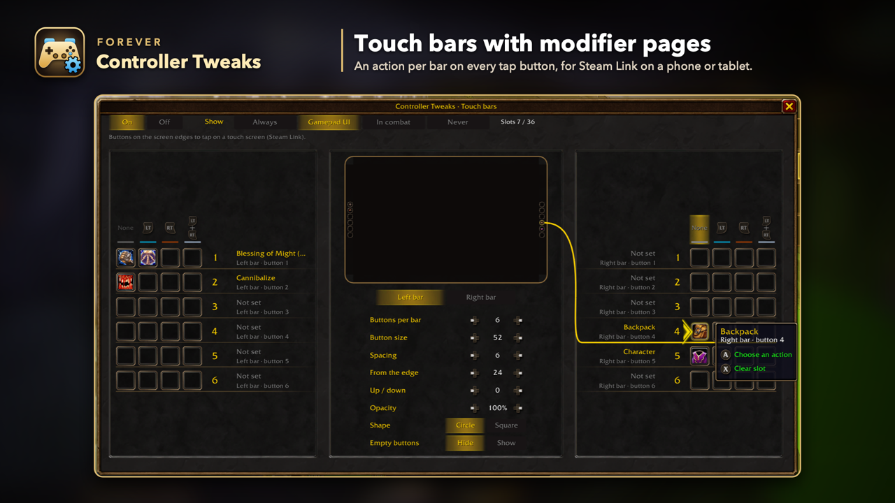 |
| 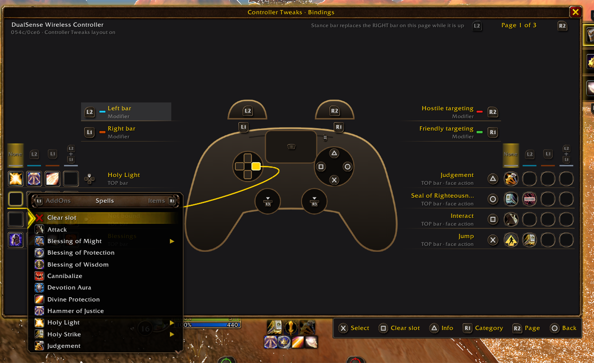 | 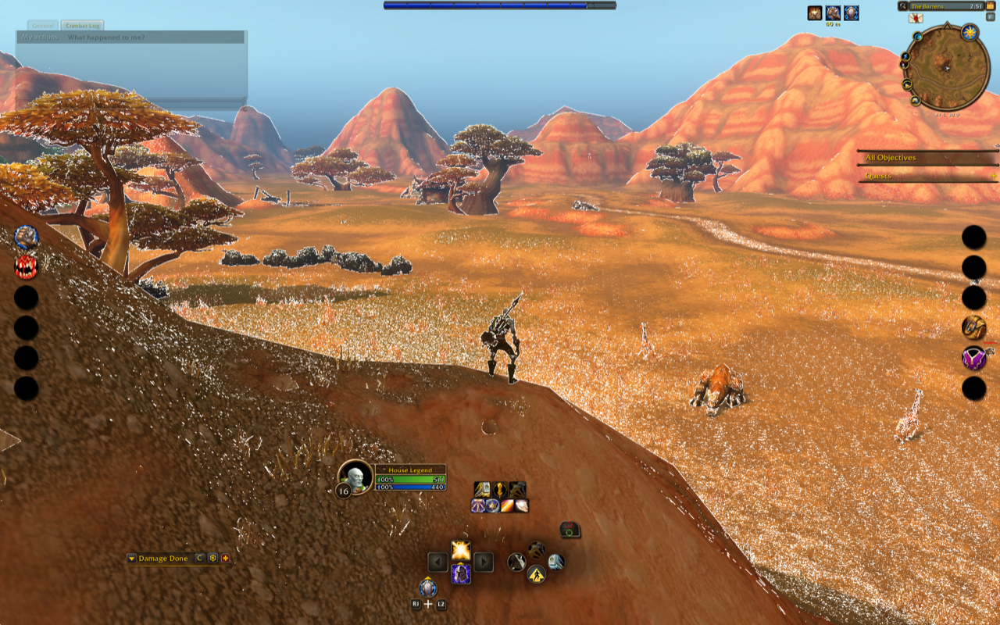 |
| 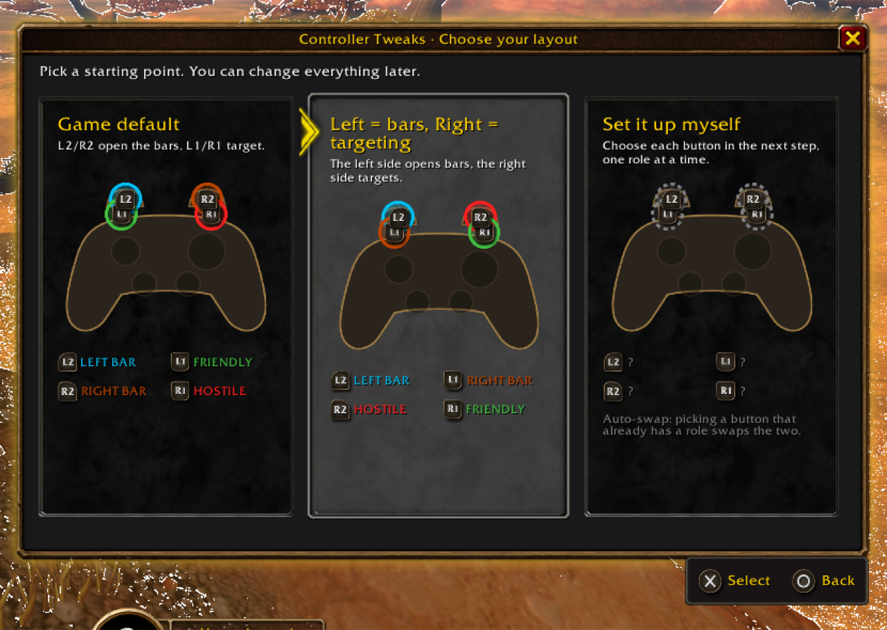 | 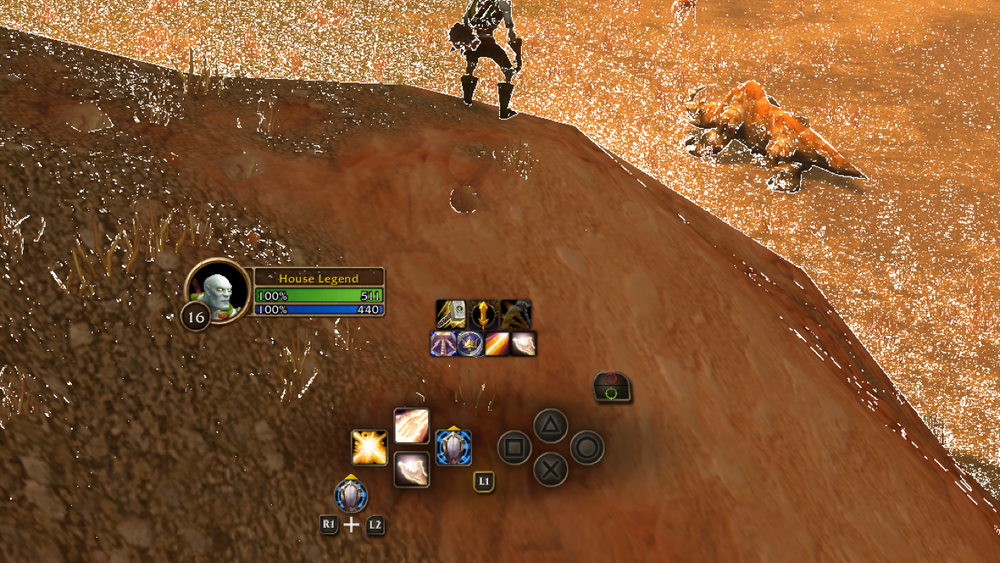 |
| 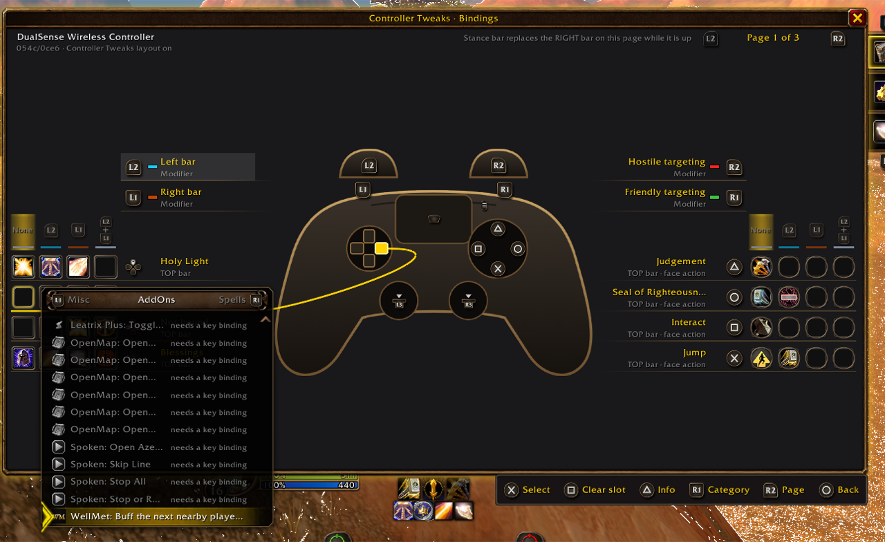 | |

## Install

**CurseForge app (recommended):** search for **Forever Controller Tweaks** and choose your WoW Forever install, or open [the CurseForge page][curseforge].

**Wago app:** search for **Forever Controller Tweaks** on [Wago][wago].

**GitHub Releases:** download `ForeverControllerTweaks-<version>.zip` from [Releases][releases] and unzip it into WoW Forever's AddOns folder.

**Manual:** copy the `ForeverControllerTweaks` folder into the AddOns folder:

- Windows: `World of Warcraft\_forever_\Interface\AddOns\`
- macOS: `/Applications/World of Warcraft/_forever_/Interface/AddOns/`

Restart the game completely (not just `/reload`), and turn on **Forever Controller Tweaks** in the AddOns list.

## Requirements

- WoW Forever (game version 1.60.1, Interface 16001).
- **Options → Gamepad → Enable Gamepad UI (Beta)** turned on. While it's off, the addon stays inactive and the controller works as the game set it up.
- A controller. See [Controllers](#controllers).

## Getting started

1. Turn on **Options → Gamepad → Enable Gamepad UI (Beta)**.
2. Log in with your controller. A short guide asks how you want to play. **Not now** keeps the game's layout, and the guide won't ask again for that controller.
3. Open the settings any time:
   - on the controller: hold **L2 + R2** and press **Create** (PlayStation), **View** (Xbox) or **Minus** (Switch);
   - the addon's **minimap button**, or the minimap **AddOns** menu;
   - **Options → AddOns → Forever Controller Tweaks**: **Open Settings**, or **Run setup guide** for the first-start guide;
   - a key of your choice: **Key Bindings → AddOns → Forever Controller Tweaks**;
   - `/fct`.

The settings open on the **Bindings** tab, and only out of combat. If you open them from Options, the Options window goes invisible underneath and comes back when you close them.

## Controllers

| Controller | Status |
|---|---|
| DualSense | Tested |
| Xbox Series / Xbox One | Tested |
| GameSir X5 Lite over Steam Link | Tested |
| DualShock 4 | Supported, not yet tested |
| Switch Pro | Supported, not yet tested |
| Back paddles (DualSense Edge, Xbox Elite) | Supported, not yet tested |
| Steam Deck | Supported, not yet tested |
| Anything else | Choose its layout when asked, or run controller setup (`/fct detect`) |

More detail, including how to report a controller, is in [docs/controllers.md](docs/controllers.md).

## Commands

`/controllertweaks` works everywhere `/fct` does.

| Command | What it does |
|---|---|
| `/fct` | Opens or closes the settings |
| `/fct bindings` | Opens the Bindings tab |
| `/fct rings` | Opens the Rings tab |
| `/fct setup` | Runs the first-start guide again |
| `/fct detect` | Controller setup (press each button) |
| `/fct family xbox` · `playstation` · `switch` · `reset` | Sets the controller type, or forgets it |
| `/fct preset native` · `split` | Game default, or Left = bars, Right = targeting |
| `/fct role <L1 R1 L2 R2 P1-P4> <leftmod rightmod friendly hostile none>` | Sets one role |
| `/fct face <bottom right left top> <interact inspect back jump>` | Moves a face action on the first page |
| `/fct reset` | Game default roles and face actions for this controller |
| `/fct release` | Clears the addon's hidden slots and `FCT:` macros before you uninstall it |
| `/fct status` | Prints the controller, layout and state |
| `/fct selftest` | Prints details for a bug report and turns the debug log on |
| `/fct debug on` · `off` | Debug log, stored in the SavedVariables |
| `/fct help` | Lists the commands |

## Known limits

- **Hidden action slots.** Actions you move onto face or D-pad buttons, and your touch bar buttons, are stored in empty slots of keyboard action bars 6–8 (slots 145–180), which the Gamepad UI never shows. Only empty slots are used, and they're freed when you clear the button. If you play with a keyboard and use those bars, you'll see them there.
- **Interact prompts in the world show the game's default Interact button.** The button icon over NPCs, herbs, ore and chests stays the default one even when you move Interact to another button. The game draws these prompts from its own locked binding, which addons can't change. To hide them, set **Options → Accessibility → Interact Key Icons** to **None**.
- **Game actions use macro slots.** Bags, Map, Target nearest enemy and the other game actions are small macros named `FCT:Bags`, `FCT:Map` and so on. The addon creates them in your account macros (or character macros when those are full) and deletes only its own, once no character uses them. Macros you made yourself are never touched.
- **Game windows in combat.** A game window (bags, talents, map) opened in combat keeps your layout's bumpers until combat ends. Out of combat, game windows get their normal L1/R1 tabs while they're open. In combat the game locks the controller setup, so the switch waits.
- **Controller setup needs a mouse or keyboard** for Skip, Back, Save and Cancel, because it records every controller button you press.
- In a vehicle, or while a pet or possess bar replaces a bar, the face buttons keep their native actions.
- The addon never changes the game's own gamepad options (CVars). Settings such as swapping the target modifiers stay in the game's Options.
- **The keyboard can't type everywhere.** The game blocks addons from typing into a few boxes, such as the Options search, the Group Finder's boxes and spellbook search. There the keyboard stays closed and says so; use a real keyboard. Slash commands (anything starting with `/` in chat) also need a real keyboard.
- English only.

## Uninstalling

Type `/fct release` first. It empties the addon's hidden slots on keyboard bars 6–8 and deletes its `FCT:` macros, so nothing is left in your action bars or macro list. (A `/reload` before uninstalling puts them back.) Then disable or delete the addon. Logging out with the addon disabled already puts the game's controller setup back to default.

## FAQ

**Will this get me banned?** No. It's an ordinary addon. It uses the game's own controller config, the same mapping the game's options write, plus secure action buttons. Nothing is automated: one press is still one action.

**Does it work in combat?** Yes. Your layout, moved actions, touch bars and glyphs work in and out of combat. Only the settings window closes when combat starts, and it offers to reopen afterwards.

**Is this ConsolePort?** No. ConsolePort replaces the game's interface. Forever Controller Tweaks keeps WoW Forever's own Gamepad UI and changes only which buttons do what.

**My controller isn't recognised, or the buttons are wrong.** Pick its layout from the cards, or run `/fct detect` and press each button when asked. It takes about a minute. If that doesn't fix it, open an [issue][issues] with the `/fct selftest` lines.

**Can I use it with other controller addons?** Usually, yes. Don't run two addons that write the controller config at the same time. If another addon already owns that config, Forever Controller Tweaks keeps a copy and puts it back when it turns off.

**How do I go back to normal?** Choose **Game default** in Bindings → More, or `/fct preset native`. Disabling the addon gives you a fully native controller after a restart.

## Help and feedback

Bug reports, controller reports and ideas are welcome in [Issues][issues]. Please include the lines `/fct selftest` prints, and crop character names and chat out of screenshots. To contribute, see [CONTRIBUTING.md](CONTRIBUTING.md).

## Credits

- [Improved Forever](https://github.com/markgravity/ImprovedForever) (MIT) and [Controller Companion](https://www.curseforge.com/wow/addons/controllercompanion) (MIT), for ideas and techniques for working with Forever's Gamepad UI.
- [ConsolePort](https://github.com/seblindfors/ConsolePort), which inspired the bindings screen and the keyboard. No ConsolePort code or art is used.
- The windows use the game's built-in art by atlas name. No Blizzard art files are shipped.
- PlayStation, Xbox, Nintendo Switch and Steam are trademarks of their respective owners. World of Warcraft is a trademark of Blizzard Entertainment, Inc. This addon isn't affiliated with or endorsed by Blizzard Entertainment.

*Made with the help of AI:* this addon was designed by HouseLegend and written with [Claude Code](https://claude.com/claude-code), Anthropic's AI coding assistant. Every change is reviewed and tested in game before release.

## Licence

[MIT](LICENSE) © 2026 HouseLegend

[site]: https://racha.github.io/forever-controller-tweaks/
[releases]: https://github.com/racha/forever-controller-tweaks/releases
[issues]: https://github.com/racha/forever-controller-tweaks/issues
[curseforge]: https://www.curseforge.com/wow/addons/forever-controller-tweaks
[wago]: https://addons.wago.io/addons/forever-controller-tweaks
